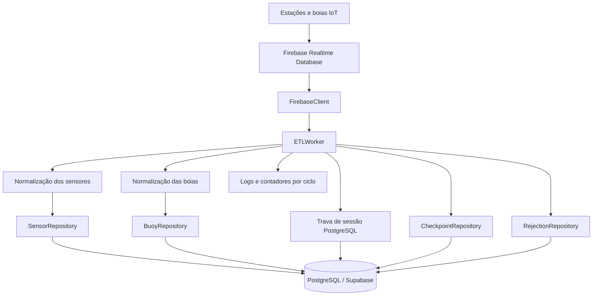

<div align="center">

# 🌱 MoRHInGA | ETL Worker Python

**Pipeline de ingestão e persistência de dados ambientais de sensores e boias IoT**


Projeto integrante do ecossistema de monitoramento ambiental **MoRHInGA**, desenvolvido no contexto do **GPADS**.

</div>

---

## 📌 Visão geral

O **MoRHInGA ETL Worker** é um serviço em Python responsável por transferir e estruturar medições ambientais armazenadas no **Firebase Realtime Database** para um banco **PostgreSQL**.

Dispositivos de campo, como estações de sensores e boias, produzem leituras com nomes de campos e formatos de data próprios. O worker consulta essas leituras, normaliza seus campos, converte datas e valores quando necessário e persiste os registros em tabelas preparadas para consultas históricas.

**ETL** significa **Extract, Transform, Load** (*Extrair, Transformar e Carregar*):

1. **Extract:** consulta os nós `sensores` e `boias` no Firebase Realtime Database.
2. **Transform:** converte os registros em objetos de domínio `Sensor` e `Buoy`, padronizando campos e timestamps.
3. **Load:** insere os dados em `sensor_data` e `buoy_data`, evitando duplicações por chave primária.

O projeto atua como uma **camada de ingestão de dados**. Ele não é, por si só, uma interface web ou uma API HTTP.

Para configurar o ambiente, use o exemplo de variáveis neste README, sem valores
reais. O [guia SQL](app/sql/README.md) documenta as migrações e permissões;
o [guia de testes](docs/TESTING.md) explica como validar o fluxo.

A [ADR de hospedagem](docs/adr-hospedagem.md) registra a decisão pelo Render Cron
e o Supabase já configurado. O worker ainda não foi implantado no Render.

Para comparar os dados e ensaiar backup, retomada e retorno sem sobrescrever o
destino, consultar o [procedimento de reconciliação](docs/ensaio-reconciliacao.md).

## 🏗️ Arquitetura e fluxo



### Funcionamento de um ciclo

Ao executar `python -m app.main`, o serviço:

1. Inicializa o logger e lê a configuração do arquivo `.env`.
2. Cria um `ETLWorker` com clientes e repositórios de persistência. Antes de cada ciclo, tenta adquirir a trava PostgreSQL; se estiver ocupada, pula o ciclo sem consultar o Firebase.
3. Lista os equipamentos de `/sensores` com uma consulta rasa.
4. Para cada equipamento, consulta `etl_checkpoint` e busca as chaves posteriores à última processada no nó `dados`. A consulta usa `start_at`, inclusivo, e descarta a leitura de fronteira.
5. Normaliza e categoriza todas as leituras do equipamento, sem interromper as demais por uma leitura inválida. Grava os válidos em lote, em páginas SQL de 500 registros, e as rejeições em `etl_rejections`. Após persistir os dois resultados, avança o checkpoint até a maior chave processada, mesmo quando há rejeições.
6. Repete o processamento para `/boias`.
7. Registra as estatísticas do ciclo no terminal.
8. Aguarda o intervalo configurado e inicia uma nova consulta.

**Importante:** a implementação principal utiliza *polling* (consultas periódicas), com espera padrão de **60 segundos após o término de cada ciclo**; não é uma agenda fixa a cada minuto. Sem checkpoint, a primeira consulta pode carregar todo o histórico de um equipamento. O arquivo `app/firebase/readers/listener.py` contém uma classe preparatória, mas o listener em tempo real **ainda não está implementado**.

**Rejeição é um resultado da classificação, não um bloqueio do ETL.** Erros de normalização, incluindo leituras que não sejam objetos JSON, são preservados com payload e motivo. Se um erro de dados/integridade no PostgreSQL derrubar um lote, ele é revertido e os registros são tentados individualmente: os válidos são inseridos e os inválidos vão para `etl_rejections`. O processamento normal não depende de correção manual na origem nem de resolução das rejeições.

**Falha de infraestrutura é diferente de rejeição.** Se o banco estiver indisponível ou não conseguir salvar um dos resultados, o checkpoint daquele equipamento fica na posição anterior para não perder leituras sem destino durável. Os commits são separados: parte dos dados pode já estar salva e será relida com segurança quanto a duplicatas no ciclo seguinte. Exceções mais amplas durante um ciclo são registradas em `main.py`, que tenta executar o ciclo seguinte após o intervalo.

### Exclusividade entre processos

Uma trava de sessão PostgreSQL (`pg_try_advisory_lock`) protege o ciclo inteiro, incluindo sensores e boias, e também o comando de reprocessamento. As chamadas diretas a `process_sensors()` e `process_buoys()` são protegidas. Todos usam uma chave fixa compartilhada no banco; chamadas aninhadas não adquirem a mesma trava repetidamente.

- Se outro processo estiver trabalhando, o loop pula o ciclo e aguarda o intervalo; o comando de reprocessamento retorna código `1`.
- A trava permanece durante os commits dos repositórios e é liberada ao sair da operação, inclusive em exceções.
- Se a sessão protegida for perdida, não há reconexão dentro daquela operação. Uma nova operação precisa adquirir a trava novamente antes de ler o Firebase ou persistir resultados.
- Se não for possível liberar a trava por SQL, a sessão original é fechada. O PostgreSQL libera a trava quando essa sessão termina.
- É necessária conexão direta ou **pooler em modo session**. Pooler em modo transaction não é compatível com esta trava de sessão.

Não é necessária migração SQL para a trava. A proteção exige que todos os processos envolvidos executem esta versão e usem o mesmo banco; pare versões antigas sem trava antes da primeira implantação. Continue configurando uma instância: exclusão mútua não é distribuição de trabalho.

## 🧰 Tecnologias

| Tecnologia | Utilização |
| --- | --- |
| Python | Implementação do worker e regras de transformação |
| Firebase Admin SDK | Autenticação e leitura do Firebase Realtime Database |
| PostgreSQL | Persistência relacional das medições |
| psycopg2 | Conexão e transações SQL |
| python-dotenv | Carregamento das variáveis de ambiente |
| colorlog | Logs coloridos no terminal |
| unittest | Testes automatizados e de integração |

As versões exatas das dependências estão fixadas em [`requirements.txt`](requirements.txt).

## 📁 Estrutura do projeto

```text
etl_worker_python/
├── app/
│   ├── config/
│   │   └── config.py                  # Variáveis de ambiente
│   ├── database/
│   │   ├── connection.py              # Conexão e transações PostgreSQL
│   │   ├── sensor_repository.py       # Implementação alternativa/legada
│   │   └── buoy_repository.py         # Implementação alternativa/legada
│   ├── firebase/
│   │   ├── client.py                  # Firebase Admin e referências RTDB
│   │   ├── paths.py                   # Caminhos dos nós no Firebase
│   │   └── readers/
│   │       └── listener.py            # Listener ainda não implementado
│   ├── models/
│   │   ├── sensor.py                  # Modelo Sensor
│   │   ├── buoy.py                    # Modelo Buoy
│   │   └── rejection.py               # Leitura rejeitada e motivo
│   ├── repository/
│   │   ├── base.py                    # Inserção em lote e transações
│   │   ├── checkpoint_repository.py   # Progresso por origem e equipamento
│   │   ├── rejection_repository.py    # Rejeições e tentativas de recuperação
│   │   ├── sensor_repository.py       # INSERT de sensores (fluxo principal)
│   │   └── buoy_repository.py         # INSERT de boias (fluxo principal)
│   ├── sql/
│   │   ├── migrations/                # Atualizações para bancos existentes
│   │   └── schema.sql                 # Medições, índices, checkpoint e rejeições
│   ├── transformer/
│   │   ├── mapper.py                  # Mapeamento de nomes dos campos
│   │   ├── normalize.py               # Normalização das leituras
│   │   └── timestamp.py               # Conversão de data e hora
│   ├── utils/
│   │   └── logger.py                  # Configuração de logs
│   ├── worker/
│   │   └── etl_worker.py              # Orquestração da ingestão
│   ├── reprocess_rejections.py        # Comando manual de recuperação
│   └── main.py                        # Entrada e loop contínuo
├── docs/                               # Análises e preparação para produção
├── legacy/                             # Bootstrap antigo, fora do fluxo principal
├── tests/                              # Testes unitários, integração e legado
├── .gitignore
├── README.md
└── requirements.txt
```

> Os repositórios em `app/repository/` são os utilizados em `ETLWorker`. Há também classes em `app/database/`; não presuma que essas implementações sejam intercambiáveis sem revisão.

## 🗃️ Estrutura dos dados no Firebase

O worker espera registros agrupados por equipamento, no formato geral:

```text
sensores/
  EST001/
    dados/
      <firebase_id>/
        hora: "2026-11-03 14:25:00"
        temperatura: 28.5
        umidade: 71
        ...

boias/
  BOIA001/
    dados/
      <firebase_id>/
        hora: "2026-11-03 14:25:00"
        ph: "7.2"
        ...
```

Esses valores são **exemplos ilustrativos**, não dados reais do sistema. Os nomes `EST001` e `BOIA001` representam os identificadores dos equipamentos; `<firebase_id>` representa a chave individual de uma leitura.

### Mapeamento de campos

| Origem: sensores | Destino |
| --- | --- |
| `ar`, `chuva`, `gas` | `ar`, `chuva`, `gas` |
| `luz`, `pressao`, `rpm` | `luz`, `pressao`, `rpm` |
| `temperatura`, `umidade`, `vento`, `volt` | `temperatura`, `umidade`, `vento`, `volt` |
| `hora` | `timestamp` |

| Origem: boias | Destino |
| --- | --- |
| `adc` | `adc` |
| `ph` | `ph` |
| `sensor_uv_v` | `sensor_uv_v` |
| `tensao_v` | `tensao_v` |
| `turbidez_v` | `turbidez_v` |
| `hora` | `timestamp` |

Os mapeamentos são definidos em `app/transformer/mapper.py`. Sensores e boias usam `hora` no formato `AAAA-MM-DD HH:MM:SS`. O formato antigo com campos em maiúsculas e `Data` separada não é aceito pelo mapper atual. Metadados como `endereco_ip` e `identificador` não são persistidos.

Em sensores e boias, valores numéricos ausentes ou vazios são convertidos para `None`; números e textos numéricos são convertidos para `float`. Booleanos, NaN, infinito e tipos inválidos são rejeitados. Sensores também possuem checagens de sanidade para alguns campos. O campo `hora` é interpretado em **`America/Sao_Paulo`**, inclusive no histórico, conforme confirmação do responsável. O parser produz datas com fuso e as medições usam `TIMESTAMPTZ`. Horários ambíguos ou inexistentes nas transições históricas de horário de verão são rejeitados para revisão, sem escolher um instante automaticamente.

## 🐘 Persistência e prevenção de duplicatas

O SQL em `app/sql/schema.sql` cria:

- **`sensor_data`**: medições de estações/sensores, incluindo temperatura, umidade, chuva, vento e outras grandezas.
- **`buoy_data`**: medições de boias, incluindo pH, turbidez, tensão e outras grandezas.
- **`etl_checkpoint`**: última chave processada por `(source, device_id)`, com data de atualização.
- **`etl_rejections`**: payload JSON, motivo, tentativas e datas de criação, última tentativa e resolução por `(source, device_id, firebase_id)`.

As duas tabelas de medições são tabelas PostgreSQL comuns e possuem índices
para consultas por tempo e equipamento.

As chaves são `(sensor_id, firebase_id)` e `(buoy_id, firebase_id)`, com `ON CONFLICT DO NOTHING`. O reprocessamento não duplica a leitura, mesmo se o horário mudar. IDs distintos no mesmo horário e IDs iguais em equipamentos diferentes são preservados. **Atenção:** a primeira versão recebida é mantida; alterações no Firebase não atualizam a linha.

Se os dados forem commitados, mas a gravação do checkpoint falhar, o próximo ciclo poderá relê-los com segurança quanto a duplicatas. A estratégia incremental depende da ordenação das chaves: novas leituras inseridas com chave anterior ao checkpoint não são buscadas automaticamente. Checkpoints não substituem backup nem uma política de reconciliação.

O código que gera as chaves nos dispositivos não está neste repositório. É necessário confirmar com a equipe de firmware a ordenação, o comportamento offline e a possibilidade de inserções atrasadas antes de aprovar essa garantia em produção.

## 🚀 Instalação e execução local

### 1. Pré-requisitos

- Python compatível com as dependências do projeto (recomenda-se começar com **Python 3.12**).
- Git.
- Banco PostgreSQL, local ou no Supabase, sem extensões adicionais.
- Projeto Firebase Realtime Database acessível.
- Uma **chave de conta de serviço** com as permissões adequadas, fornecida de forma segura pela equipe responsável.

> Não inclua o JSON de credenciais em commits, mensagens, prints ou arquivos públicos.

### 2. Clone o repositório

```bash
git clone https://github.com/GpadsTech/etl_worker_python.git
cd etl_worker_python
```

### 3. Crie e ative um ambiente virtual

**Windows — Git Bash:**

```bash
py -3.12 -m venv .venv
source .venv/Scripts/activate
```

**Windows — PowerShell:**

```powershell
py -3.12 -m venv .venv
.\.venv\Scripts\Activate.ps1
```

**Linux/macOS:**

```bash
python3 -m venv .venv
source .venv/bin/activate
```

### 4. Instale as dependências

```bash
python -m pip install --upgrade pip
python -m pip install -r requirements.txt
```

### 5. Configure as variáveis de ambiente

Use `.env.example` como modelo para o `.env` na raiz do projeto; não sobrescreva
um `.env` existente com credenciais reais.

Os modelos versionados estão separados por perfil:

| Modelo | Arquivo privado | Uso |
| --- | --- | --- |
| [`.env.example`](.env.example) | `.env` | Inicialização/administração do PostgreSQL local |
| [`.env.etl.example`](.env.etl.example) | `.env.etl` | Worker local com login restrito |
| [`.env.supabase.example`](.env.supabase.example) | `.env.supabase` | Administração e migrações no Supabase |
| [`.env.supabase.etl.example`](.env.supabase.etl.example) | `.env.supabase.etl` | Worker com login restrito no Supabase |

Copiar apenas os modelos necessários, preencher os placeholders e proteger os
arquivos privados com permissão `0600` em Linux/macOS. Não usar o perfil
administrativo para executar o worker nem substituir arquivos já preenchidos.
`ETL_ENV_FILE` é informado no comando de execução, não dentro do arquivo escolhido.

```dotenv
FIREBASE_DATABASE_URL=https://SEU-PROJETO-default-rtdb.firebaseio.com
FIREBASE_CREDENTIALS=app/firebase/credentials/firebase_key.json

POSTGRES_HOST=localhost
POSTGRES_PORT=5432
POSTGRES_DB=moringa
POSTGRES_USER=postgres
POSTGRES_PASSWORD=SUA_SENHA_LOCAL
POSTGRES_SCHEMA=etl_private
POSTGRES_SSLMODE=disable
POSTGRES_SSLROOTCERT=
POSTGRES_CONNECT_TIMEOUT=10
POSTGRES_STATEMENT_TIMEOUT_MS=60000
POSTGRES_LOCK_TIMEOUT_MS=5000

ETL_INTERVAL_SECONDS=60
```

| Variável | Descrição |
| --- | --- |
| `FIREBASE_DATABASE_URL` | URL do Realtime Database do projeto Firebase |
| `FIREBASE_CREDENTIALS` | Caminho do JSON da conta de serviço, absoluto ou relativo à raiz do projeto |
| `POSTGRES_HOST` | Host do servidor PostgreSQL |
| `POSTGRES_PORT` | Porta do PostgreSQL; padrão `5432` |
| `POSTGRES_DB` | Nome do banco de dados |
| `POSTGRES_USER` | Usuário de conexão |
| `POSTGRES_PASSWORD` | Senha de conexão |
| `POSTGRES_SCHEMA` | Schema de acesso; padrão `etl_private`; identificador simples em minúsculas |
| `POSTGRES_SSLMODE` | `disable`, `allow`, `prefer`, `require`, `verify-ca` ou `verify-full`; omitido: `disable` em loopback e `verify-full` nos demais hosts |
| `POSTGRES_SSLROOTCERT` | Caminho de arquivo CA legível; omitido usa a configuração de confiança padrão do libpq |
| `POSTGRES_CONNECT_TIMEOUT` | Timeout de conexão em segundos; padrão `10`, mínimo `1` (libpq usa no mínimo 2 segundos) |
| `POSTGRES_STATEMENT_TIMEOUT_MS` | Duração máxima por comando SQL; padrão `60000` ms; `0` desativa |
| `POSTGRES_LOCK_TIMEOUT_MS` | Espera máxima por lock SQL; padrão `5000` ms; `0` desativa |
| `ETL_INTERVAL_SECONDS` | Intervalo entre ciclos; padrão `60` segundos |
| `ETL_ENV_FILE` | Arquivo de configuração alternativo, informado no ambiente do processo; omitido mantém `.env` |

**Supabase:** use os valores de host, porta, banco e usuário fornecidos pelo painel.
Escolha conexão direta ou pooler **session**, nunca transaction por causa da trava
de sessão. Configure `POSTGRES_SSLMODE=verify-full` e a CA confiável apropriada
em `POSTGRES_SSLROOTCERT` (ou no local padrão do libpq). `require` exige criptografia,
mas não garante a verificação do hostname. Limites e schema são aplicados
explicitamente na sessão após conectar, pois o pooler pode sobrescrever opções
de startup; reconexões reaplicam a configuração e não ocorrem durante uma trava
perdida. Valores inválidos são recusados sem imprimir credenciais.

O caminho da credencial acima é **um exemplo local** compatível com a forma como `FirebaseClient` resolve o arquivo. Crie as pastas necessárias e coloque o JSON fora do versionamento. O `.gitignore` já possui regras para configurações privadas e diretórios de credenciais, incluindo:

```gitignore
.env
.venv/
__pycache__/
*.pyc
**/credentials/
```

> O `.gitignore` não remove arquivos já rastreados nem saneia o histórico. Confirme a procedência das credenciais e revogue/substitua qualquer chave que tenha sido exposta. Em produção, use um secret file externo à imagem e ao Git.

### 6. Inicialize o PostgreSQL

#### Banco local com Docker Compose

O `docker-compose.yml` usa PostgreSQL **18.7**, com usuário, senha, banco e porta
do `.env` existente. Na configuração local atual, o worker continua acessando
`localhost:5433`; a porta interna do container é `5432`.

Pare o banco anterior se ele ocupar a mesma porta e execute:

```bash
docker compose up -d --wait postgres
docker compose ps
```

O serviço fica acessível apenas na máquina local. Os dados ficam no volume
`postgres18_data`, separado do banco antigo. O schema é criado automaticamente
**somente na primeira inicialização com volume vazio**: `schema.sql` executa as
migrações 000/001/002/003/004 automaticamente. Dados do banco anterior não são importados.
Não reutilize o volume antigo nem execute `docker compose down -v` se quiser
preservar os dados.

Para parar sem apagar o volume:

```bash
docker compose down
```

#### Banco sem Docker ou já existente

Para banco novo ou existente, execute a entrada `psql`, que aplica as migrações
000 → 001 → 002 → 003 → 004 em ordem e interrompe em caso de erro:

```bash
psql -h localhost -U postgres -d moringa -v ON_ERROR_STOP=1 -f app/sql/schema.sql
```

Adapte host, usuário e nome do banco conforme seu `.env`. O usuário de migração precisa ser dono das tabelas e poder criar schema/roles (`CREATEROLE`). Não use essa credencial administrativa no worker. PostgreSQL puro é o único destino suportado.

**Banco já existente:** com o ETL parado, valide e aplique as migrações em ordem no ambiente de teste. A 002 exige tabelas comuns, sem particionamento/herança, e aborta diante de duplicidades por equipamento/ID, sem apagar dados. Estruturas antigas gerenciadas por extensão precisam ser transferidas para tabelas comuns; não há conversão automática nem exclusão de dados. Não inicie o worker atualizado antes de atualizar as chaves. Em produção, faça backup e valide em homologação.

```bash
psql -h localhost -U postgres -d moringa -v ON_ERROR_STOP=1 -f app/sql/migrations/000_initial_schema.sql
psql -h localhost -U postgres -d moringa -v ON_ERROR_STOP=1 -f app/sql/migrations/001_etl_rejections.sql
psql -h localhost -U postgres -d moringa -v ON_ERROR_STOP=1 -f app/sql/migrations/002_device_reading_identity.sql
psql -h localhost -U postgres -d moringa -v ON_ERROR_STOP=1 -f app/sql/migrations/003_private_access.sql
psql -h localhost -U postgres -d moringa -v ON_ERROR_STOP=1 -f app/sql/migrations/004_measurement_timestamptz.sql
```

Os comandos individuais acima são alternativa ao `schema.sql`, não uma etapa
adicional. Toda a definição está nas migrações; `schema.sql` apenas as inclui com
`\ir`, portanto requer **psql**, não execução direta por psycopg2 ou pelo SQL Editor.
No SQL Editor do Supabase, executar o conteúdo das migrações individualmente em ordem.
Não há executor com histórico automático: registrar externamente as versões
aplicadas. Depois da 003, `schema.sql` detecta a transferência e executa apenas 003/004,
sem recriar as tabelas em `public`. Não reaplicar manualmente 000/001/002 após essa
etapa. Executar com o ETL parado, não a cada inicialização.

A migração não é executada automaticamente pelo worker e não recupera leituras rejeitadas por versões anteriores, que tenham ficado apenas nos logs.

#### Permissões e Data API

A 003 move sensores, boias, checkpoints e rejeições para `etl_private`.
As roles `etl_writer` e `ai_reader` são grupos sem login nem senha:
ETL insere/consulta medições e atualiza seu estado; IA só consulta medições.
Nenhum usuário é associado automaticamente. Provisionar a credencial restrita
do worker separadamente; manter a IA sem login até existir um consumidor.

**Não expor `etl_private` pela Data API.** A migração revoga acesso de `PUBLIC`
e das roles de API existentes (`anon`, `authenticated`, `service_role`).
Não há políticas RLS porque a opção adotada é acesso PostgreSQL privado.
Veja [migrações e provisionamento](app/sql/README.md).
Aplicar a 003 antes de usar o novo padrão `POSTGRES_SCHEMA=etl_private`.
Aplicar a 004 antes de executar o parser com fuso. Ela converte o histórico com
`timestamp AT TIME ZONE 'America/Sao_Paulo'`, sem depender do fuso da sessão.
`TIMESTAMPTZ` representa o instante; a exibição depende do fuso do cliente.
Para visualizar no horário de origem: `timestamp AT TIME ZONE 'America/Sao_Paulo'`.
Não usar UTC−03:00 fixo para todo o histórico, pois houve horário de verão.

Para separar a credencial administrativa local da credencial restrita do worker,
usar um arquivo privado `.env.etl` e iniciar com:

```bash
ETL_ENV_FILE=.env.etl .venv/bin/python -m app.main
```

O `.env` original continua disponível para administrar o banco e inicializar o
Docker Compose. `.env.etl` deve ficar fora do Git e legível apenas pelo proprietário.
Variáveis já exportadas no processo têm precedência sobre o arquivo escolhido.

No Supabase provisionado, usar `.env.supabase` somente para migrações/administração
e `.env.supabase.etl` para o worker, com credencial restrita:

```bash
ETL_ENV_FILE=.env.supabase.etl .venv/bin/python -m app.main
```

Esse comando inicia a ingestão permanente; testes de integração comuns usam
tabelas temporárias e não carregam o histórico nas tabelas definitivas.

### 7. Execute o ETL

Na raiz do projeto, com o ambiente virtual ativo:

```bash
python -m app.main
```

O worker executa ciclos continuamente até ser interrompido. Para encerrar com segurança, pressione **Ctrl+C**. O fluxo principal fecha a conexão com o banco ao finalizar.

### 8. Verifique a ingestão

Os logs mostram, separadamente para sensores e boias:

- **Recebidos:** registros posteriores ao checkpoint, antes da validação do formato e dos campos.
- **Inseridos:** novas linhas persistidas no banco.
- **Já existentes:** leituras ignoradas por conflito na chave primária.
- **Erros:** leituras com falha na normalização ou persistência.

Esses contadores não substituem o diagnóstico operacional: falhas ao salvar rejeições ou checkpoints também são registradas nos logs e podem deixar o progresso na posição anterior. Uma mensagem de ciclo concluído, isoladamente, não comprova que todos os checkpoints avançaram.

Para conferir no PostgreSQL:

```sql
SELECT COUNT(*) FROM sensor_data;
SELECT COUNT(*) FROM buoy_data;

SELECT sensor_id, timestamp, temperatura, umidade
FROM sensor_data
ORDER BY timestamp DESC
LIMIT 10;

SELECT buoy_id, timestamp, ph, turbidez_v
FROM buoy_data
ORDER BY timestamp DESC
LIMIT 10;
```

### 9. Reprocessamento opcional de rejeições

O fluxo esperado é somente extração e classificação, sem alterações manuais no Firebase. Rejeições ficam registradas para auditoria e **não precisam ser resolvidas para o ETL continuar**. O comando abaixo é uma ferramenta excepcional de manutenção, não uma etapa obrigatória da ingestão.

Se precisar utilizá-lo, use um ambiente configurado para o banco correto. O comando disputa a mesma trava da ingestão; se ela estiver ocupada, não inicia. Para uma janela de manutenção previsível, pare o worker antes de executar a recuperação.

```bash
# Após corrigir o normalizador: usa o payload salvo, sem consultar Firebase.
python -m app.reprocess_rejections --limit 100

# Após corrigir a leitura no Firebase: relê o registro pela chave exata.
python -m app.reprocess_rejections --source sensores --device-id EST001 --limit 50 --refresh-from-firebase
```

Cada comando processa **um lote** de rejeições pendentes, priorizando as tentativas mais antigas. Não existe reprocessamento automático das rejeições no loop principal nem edição automática de payloads. Falhas operacionais da ingestão podem causar releitura no ciclo seguinte, pois impedem o avanço do checkpoint. `--source` e `--device-id` são filtros opcionais.

- O registro só é marcado como resolvido após o commit da medição. Uma medição já existente também permite resolver a rejeição, sem atualizar seus valores.
- Falhas de normalização, leitura ou insert mantêm a rejeição pendente e atualizam motivo/tentativas.
- O reprocessamento preserva o payload salvo, mesmo ao reler o Firebase, e não move checkpoints.
- Ausência da leitura no Firebase não apaga a rejeição.
- Falha ao registrar a tentativa ou resolução interrompe o comando; se a medição já foi commitada, repetir é seguro quanto a duplicatas.
- O código de saída é `0` quando não há erros no lote (inclusive lote vazio), `1` em falhas e `2` para argumentos inválidos.

As rejeições contêm dados brutos e mensagens de erro: restrinja acesso à tabela e aos backups, não exponha payloads em logs e defina retenção antes da produção. Replay da ingestão atualiza a rejeição existente e pode reabri-la; o payload é preservado durante o reprocessamento, não um histórico imutável de todas as versões.

## 🧪 Testes

O repositório separa testes unitários offline de testes de integração. O teste de bootstrap legado está fora da suíte ativa.

Para executar somente os testes offline:

```bash
python -m tests
# Alternativa com unittest:
python -m unittest discover -s tests/unit -t . -q
```

Para um teste específico:

```bash
python -m unittest tests.unit.test_etl_worker
```

As integrações são puladas por padrão e exigem autorização explícita:

```bash
RUN_INTEGRATION=1 python -m tests.runner integration
```

No PowerShell, defina `$env:RUN_INTEGRATION = "1"` antes do comando e remova a variável ao terminar. Use somente credenciais e banco de teste. Os testes comuns de escrita SQL usam tabelas temporárias por sessão; isso não valida desempenho dos índices. A suíte de permissões exige autorização extra e cluster descartável, pois cria roles e objetos permanentes. Consulte [TESTING.md](docs/TESTING.md) para detalhes.

## 🔧 Diagnóstico de problemas

| Sintoma | Possível causa e verificação |
| --- | --- |
| `FileNotFoundError` para credenciais | Revise `FIREBASE_CREDENTIALS` e a existência do JSON local |
| Erro de autenticação Firebase | Verifique a validade da conta de serviço e suas permissões |
| Erro de conexão com PostgreSQL | Confirme host, porta, banco, usuário, senha e servidor ativo |
| Migração 002 recusa tabelas com particionamento/herança | Transfira os dados para tabelas PostgreSQL comuns antes de aplicar a migração |
| Erro ao converter timestamps | Compare os formatos das datas do Firebase com `timestamp.py` |
| Erro de conversão numérica | Verifique strings e valores dos campos de boias/sensores |
| Zero registros recebidos | Pode não haver chaves posteriores ao checkpoint; confira também os nós `sensores/{id}/dados` e `boias/{id}/dados` |
| Zero registros novos, mas registros existentes | O mecanismo de idempotência pode estar ignorando leituras já salvas |
| Push bloqueado pelo GitHub | Remova segredos dos commits e revise o `.gitignore`; não contorne a proteção |

## ⚠️ Escopo atual e melhorias futuras

### Já implementado no fluxo principal

- Consultas periódicas incrementais ao Firebase Realtime Database.
- Processamento separado de sensores e boias.
- Normalização de campos e timestamps.
- Persistência em lote no PostgreSQL.
- Checkpoint no banco por origem e equipamento.
- Persistência durável de rejeições, sem bloquear o avanço por dados inválidos.
- Isolamento de erros SQL de dados/integridade para não descartar os válidos do lote.
- Comando opcional de reprocessamento, fora do fluxo normal.
- Trava PostgreSQL compartilhada entre ingestão e reprocessamento, sem reconexão durante a operação protegida.
- Proteção contra duplicatas via `ON CONFLICT DO NOTHING`.
- Logs e contadores por ciclo.
- Tratamento de falhas por registro.

### Pontos que ainda exigem atenção

- **Listener em tempo real:** `listener.py` ainda não implementa a escuta efetiva.
- **Carga inicial e backlog:** a leitura Firebase ainda não é paginada; todo o resultado por equipamento pode ficar em memória.
- **Integridade:** falta confirmar o contrato das chaves com o firmware e definir reconciliação para chaves atrasadas; rejeições anteriores à nova tabela não são recuperadas automaticamente.
- **Concorrência:** a trava está implementada e coberta por testes offline; falta validar disputa entre processos, encerramento abrupto e o modo de conexão no ambiente de homologação.
- **Atualização de leituras:** o mecanismo de conflito não atualiza registros existentes.
- **Operação:** faltam tratamento explícito de SIGTERM, timeouts, recuperação robusta de conexão e alertas de ausência de sucesso.
- **Deploy e segurança:** containerização, CI, validação de TLS, gestão de segredos e restauração de backups precisam ser preparados e testados.

A [ADR de hospedagem](docs/adr-hospedagem.md) registra o **Render Cron diário**
e o PostgreSQL do Supabase aprovado e configurado. A implantação do worker no
Render e o dimensionamento operacional continuam pendentes.

**A execução agendada ainda não está implementada:** o método `ETLWorker.run_once()` existe, mas o módulo previsto `app.run_once` ainda não foi criado. Ele precisará fechar conexões e retornar um código de saída que distinga falhas operacionais de rejeições persistidas. **Não agende `python -m app.main` como cron**, pois esse comando executa um loop contínuo. A automação de migrações no deploy também permanece pendente.

Listener em tempo real é uma evolução opcional, não um requisito para hospedar a ingestão atual.

## 🤝 Contribuição

Para contribuir, crie uma branch com uma alteração focada, execute os testes pertinentes e abra um Pull Request descrevendo o objetivo, o impacto e os procedimentos de validação. Nunca inclua credenciais, senhas, dumps privados ou dados sensíveis nos commits.

## 🔗 Repositório e contexto

- **Código-fonte:** [GpadsTech/etl_worker_python](https://github.com/GpadsTech/etl_worker_python)
- **Contexto:** pipeline de dados ambientais do projeto **MoRHInGA / GPADS**.

---

<div align="center">

**MoRHInGA • Ingestão de dados ambientais para análise histórica**

</div>
