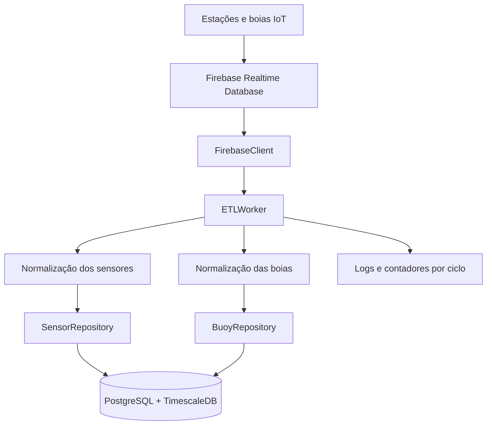

<div align="center">

# 🌱 MoRHInGA | ETL Worker Python

**Pipeline de ingestão e persistência de dados ambientais de sensores e boias IoT**


Projeto integrante do ecossistema de monitoramento ambiental **MoRHInGA**, desenvolvido no contexto do **GPADS**.

</div>

---

## 📌 Visão geral

O **MoRHInGA ETL Worker** é um serviço em Python responsável por transferir e estruturar medições ambientais armazenadas no **Firebase Realtime Database** para um banco **PostgreSQL com extensão TimescaleDB**.

Dispositivos de campo, como estações de sensores e boias, produzem leituras com nomes de campos e formatos de data próprios. O worker consulta essas leituras, normaliza seus campos, converte datas e valores quando necessário e persiste os registros em tabelas preparadas para consultas históricas.

**ETL** significa **Extract, Transform, Load** (*Extrair, Transformar e Carregar*):

1. **Extract:** consulta os nós `sensores` e `boias` no Firebase Realtime Database.
2. **Transform:** converte os registros em objetos de domínio `Sensor` e `Buoy`, padronizando campos e timestamps.
3. **Load:** insere os dados em `sensor_data` e `buoy_data`, evitando duplicações por chave primária.

O projeto atua como uma **camada de ingestão de dados**. Ele não é, por si só, uma interface web ou uma API HTTP.

## 🏗️ Arquitetura e fluxo



### Funcionamento de um ciclo

Ao executar `python -m app.main`, o serviço:

1. Inicializa o logger e lê a configuração do arquivo `.env`.
2. Cria um `ETLWorker` com clientes e repositórios de persistência.
3. Consulta os registros de sensores em `/sensores`.
4. Para cada equipamento, percorre os registros localizados no nó `dados`.
5. Normaliza e tenta inserir cada leitura no banco, contando inserções, duplicatas e erros.
6. Repete o processamento para `/boias`.
7. Registra as estatísticas do ciclo no terminal.
8. Aguarda o intervalo configurado e inicia uma nova consulta.

**Importante:** a implementação principal utiliza *polling* (consultas periódicas), com intervalo padrão de **60 segundos**. O arquivo `app/firebase/readers/listener.py` contém uma classe preparatória, mas o listener em tempo real **ainda não está implementado**.

Uma falha no processamento de uma leitura é registrada e não impede, por si só, que as demais leituras daquele grupo continuem sendo processadas. Exceções mais amplas durante um ciclo são registradas em `main.py`, que tenta executar o ciclo seguinte após o intervalo.

## 🧰 Tecnologias

| Tecnologia | Utilização |
| --- | --- |
| Python | Implementação do worker e regras de transformação |
| Firebase Admin SDK | Autenticação e leitura do Firebase Realtime Database |
| PostgreSQL | Persistência relacional das medições |
| TimescaleDB | Extensão de séries temporais e hypertables |
| psycopg2 | Conexão e transações SQL |
| python-dotenv | Carregamento das variáveis de ambiente |
| colorlog | Logs coloridos no terminal |
| unittest | Testes automatizados e de integração |

As versões exatas das dependências estão fixadas em [`requirements.txt`](requirements.txt).

## 📁 Estrutura do projeto

```text
etl_worker_python/
├── app/
│   ├── config/
│   │   └── config.py                  # Variáveis de ambiente
│   ├── database/
│   │   ├── connection.py              # Conexão e transações PostgreSQL
│   │   ├── sensor_repository.py       # Implementação alternativa/legada
│   │   └── buoy_repository.py         # Implementação alternativa/legada
│   ├── firebase/
│   │   ├── client.py                  # Firebase Admin e referências RTDB
│   │   ├── paths.py                   # Caminhos dos nós no Firebase
│   │   └── readers/
│   │       ├── bootstrap.py           # Rotina auxiliar de importação
│   │       └── listener.py            # Listener ainda não implementado
│   ├── models/
│   │   ├── sensor.py                  # Modelo Sensor
│   │   └── buoy.py                    # Modelo Buoy
│   ├── repository/
│   │   ├── sensor_repository.py       # INSERT de sensores (fluxo principal)
│   │   └── buoy_repository.py         # INSERT de boias (fluxo principal)
│   ├── sql/
│   │   ├── init_timescale.sql         # Ativação da extensão TimescaleDB
│   │   └── schema.sql                 # Tabelas, hypertables e índices
│   ├── transformer/
│   │   ├── mapper.py                  # Mapeamento de nomes dos campos
│   │   ├── normalize.py               # Normalização das leituras
│   │   └── timestamp.py               # Conversão de data e hora
│   ├── utils/
│   │   └── logger.py                  # Configuração de logs
│   ├── worker/
│   │   └── etl_worker.py              # Orquestração da ingestão
│   └── main.py                        # Entrada e loop contínuo
├── tests/                              # Testes do projeto
├── .gitignore
├── README.md
└── requirements.txt
```

> Os repositórios em `app/repository/` são os utilizados em `ETLWorker`. Há também classes em `app/database/`; não presuma que essas implementações sejam intercambiáveis sem revisão.

## 🗃️ Estrutura dos dados no Firebase

O worker espera registros agrupados por equipamento, no formato geral:

```text
sensores/
  EST001/
    dados/
      <firebase_id>/
        Hora: "2026-11-03 14:25:00"
        Temperatura: 28.5
        Umidade: 71
        ...

boias/
  BOIA001/
    dados/
      <firebase_id>/
        Data: "03/11/2026"
        Hora: "14:25:00"
        Ph: "7.2"
        ...
```

Esses valores são **exemplos ilustrativos**, não dados reais do sistema. Os nomes `EST001` e `BOIA001` representam os identificadores dos equipamentos; `<firebase_id>` representa a chave individual de uma leitura.

### Mapeamento de campos

| Origem: sensores | Destino |
| --- | --- |
| `Ar`, `Chuva`, `Gas` | `ar`, `chuva`, `gas` |
| `Luz`, `Pressao`, `Rpm` | `luz`, `pressao`, `rpm` |
| `Temperatura`, `Umidade`, `Vento`, `Volt` | `temperatura`, `umidade`, `vento`, `volt` |
| `Hora` | `timestamp` |

| Origem: boias | Destino |
| --- | --- |
| `ADC` | `adc` |
| `Ph` | `ph` |
| `Sensor UV(V)` | `sensor_uv_v` |
| `Tensão(V)` | `tensao_v` |
| `Turbidez(V)` | `turbidez_v` |
| `Data` + `Hora` | `timestamp` |

Os mapeamentos são definidos em `app/transformer/mapper.py`. Para os sensores, o timestamp esperado usa `AAAA-MM-DD HH:MM:SS`; para as boias, `DD/MM/AAAA` e `HH:MM:SS` são combinados. Outros formatos exigem adaptação de `app/transformer/timestamp.py`.

Em leituras de boias, valores numéricos vazios podem ser convertidos para `None`; valores numéricos não vazios são convertidos para `float`. Entradas com formatos inválidos podem gerar erros de normalização, registrados pelo worker.

## 🐘 Persistência e prevenção de duplicatas

O SQL em `app/sql/schema.sql` cria:

- **`sensor_data`**: medições de estações/sensores, incluindo temperatura, umidade, chuva, vento e outras grandezas.
- **`buoy_data`**: medições de boias, incluindo pH, turbidez, tensão e outras grandezas.

As duas tabelas são convertidas em **hypertables** por `timestamp` e possuem índices para consultas por tempo e equipamento.

A chave primária é composta por `(firebase_id, timestamp)`. Nas inserções, o projeto usa:

```sql
ON CONFLICT (firebase_id, timestamp)
DO NOTHING
```

Com isso, o reprocessamento da mesma leitura não gera outra linha com a mesma chave. **Atenção:** esse comportamento também significa que uma leitura já inserida **não é atualizada** caso seu conteúdo mude no Firebase.

## 🚀 Instalação e execução local

### 1. Pré-requisitos

- Python compatível com as dependências do projeto (recomenda-se começar com **Python 3.12**).
- Git.
- Banco PostgreSQL com a extensão TimescaleDB instalada e disponível.
- Projeto Firebase Realtime Database acessível.
- Uma **chave de conta de serviço** com as permissões adequadas, fornecida de forma segura pela equipe responsável.

> Não inclua o JSON de credenciais em commits, mensagens, prints ou arquivos públicos.

### 2. Clone o repositório

```bash
git clone https://github.com/GpadsTech/etl_worker_python.git
cd etl_worker_python
```

### 3. Crie e ative um ambiente virtual

**Windows — Git Bash:**

```bash
py -3.12 -m venv .venv
source .venv/Scripts/activate
```

**Windows — PowerShell:**

```powershell
py -3.12 -m venv .venv
.\.venv\Scripts\Activate.ps1
```

**Linux/macOS:**

```bash
python3 -m venv .venv
source .venv/bin/activate
```

### 4. Instale as dependências

```bash
python -m pip install --upgrade pip
python -m pip install -r requirements.txt
```

### 5. Configure as variáveis de ambiente

Crie um arquivo `.env` na raiz do projeto:

```dotenv
FIREBASE_DATABASE_URL=https://SEU-PROJETO-default-rtdb.firebaseio.com
FIREBASE_CREDENTIALS=app/firebase/credentials/firebase_key.json

POSTGRES_HOST=localhost
POSTGRES_PORT=5432
POSTGRES_DB=moringa
POSTGRES_USER=postgres
POSTGRES_PASSWORD=SUA_SENHA_LOCAL

ETL_INTERVAL_SECONDS=60
```

| Variável | Descrição |
| --- | --- |
| `FIREBASE_DATABASE_URL` | URL do Realtime Database do projeto Firebase |
| `FIREBASE_CREDENTIALS` | Caminho local do JSON da conta de serviço, relativo à raiz do projeto |
| `POSTGRES_HOST` | Host do servidor PostgreSQL |
| `POSTGRES_PORT` | Porta do PostgreSQL; padrão `5432` |
| `POSTGRES_DB` | Nome do banco de dados |
| `POSTGRES_USER` | Usuário de conexão |
| `POSTGRES_PASSWORD` | Senha de conexão |
| `ETL_INTERVAL_SECONDS` | Intervalo entre ciclos; padrão `60` segundos |

O caminho da credencial acima é **um exemplo local** compatível com a forma como `FirebaseClient` resolve o arquivo. Crie as pastas necessárias e coloque o JSON fora do versionamento. Verifique se o `.gitignore` contém **exatamente** entradas como:

```gitignore
.env
.venv/
__pycache__/
*.pyc
app/firebase/credentials/*.json
```

> **Observação de segurança do repositório em 03/11/2026:** o `.gitignore` examinado possui uma entrada concatenada (`.vscode/app/firebase/credentials/firebase_key.json`) que **não protege corretamente** o caminho do JSON. Corrija essa entrada antes de adicionar arquivos ao Git. Se alguma chave privada já tiver sido exposta, revogue-a e emita uma nova.

### 6. Inicialize o TimescaleDB

Depois de criar o banco PostgreSQL e disponibilizar a extensão TimescaleDB, execute os scripts SQL **nesta ordem**:

```bash
psql -h localhost -U postgres -d moringa -f app/sql/init_timescale.sql
psql -h localhost -U postgres -d moringa -f app/sql/schema.sql
```

Adapte host, usuário e nome do banco conforme seu `.env`. O comando `psql` requer o cliente PostgreSQL instalado e disponível no terminal. O usuário do banco precisa ter permissões para criar a extensão, tabelas e índices, ou essas etapas devem ser executadas por um administrador.

### 7. Execute o ETL

Na raiz do projeto, com o ambiente virtual ativo:

```bash
python -m app.main
```

O worker executa ciclos continuamente até ser interrompido. Para encerrar com segurança, pressione **Ctrl+C**. O fluxo principal fecha a conexão com o banco ao finalizar.

### 8. Verifique a ingestão

Os logs mostram, separadamente para sensores e boias:

- **Recebidos:** registros válidos para tentativa de processamento.
- **Inseridos:** novas linhas persistidas no banco.
- **Já existentes:** leituras ignoradas por conflito na chave primária.
- **Erros:** leituras com falha na normalização ou persistência.

Para conferir no PostgreSQL:

```sql
SELECT COUNT(*) FROM sensor_data;
SELECT COUNT(*) FROM buoy_data;

SELECT sensor_id, timestamp, temperatura, umidade
FROM sensor_data
ORDER BY timestamp DESC
LIMIT 10;

SELECT buoy_id, timestamp, ph, turbidez_v
FROM buoy_data
ORDER BY timestamp DESC
LIMIT 10;
```

## 🧪 Testes

O repositório contém testes para conexão, transformação, timestamps, bootstrap, worker, idempotência e persistência.

Para executar os testes com o `unittest`:

```bash
python -m unittest discover -s tests -p "test*.py"
```

Para um teste específico:

```bash
python -m unittest tests.test_etl_worker
```

**Atenção:** vários testes podem acessar Firebase e PostgreSQL reais. Eles precisam de configuração válida e podem escrever dados. Execute-os preferencialmente com ambientes e bancos de teste; resultados dependem da disponibilidade dos serviços e da presença de leituras de exemplo.

## 🔧 Diagnóstico de problemas

| Sintoma | Possível causa e verificação |
| --- | --- |
| `FileNotFoundError` para credenciais | Revise `FIREBASE_CREDENTIALS` e a existência do JSON local |
| Erro de autenticação Firebase | Verifique a validade da conta de serviço e suas permissões |
| Erro de conexão com PostgreSQL | Confirme host, porta, banco, usuário, senha e servidor ativo |
| `function create_hypertable does not exist` | Instale/ative a extensão TimescaleDB antes do `schema.sql` |
| Erro ao converter timestamps | Compare os formatos das datas do Firebase com `timestamp.py` |
| Erro de conversão numérica | Verifique strings e valores dos campos de boias/sensores |
| Zero registros recebidos | Confira os nós `sensores/{id}/dados` e `boias/{id}/dados` |
| Zero registros novos, mas registros existentes | O mecanismo de idempotência pode estar ignorando leituras já salvas |
| Push bloqueado pelo GitHub | Remova segredos dos commits e revise o `.gitignore`; não contorne a proteção |

## ⚠️ Escopo atual e melhorias futuras

### Já implementado no fluxo principal

- Consultas periódicas ao Firebase Realtime Database.
- Processamento separado de sensores e boias.
- Normalização de campos e timestamps.
- Persistência no PostgreSQL/TimescaleDB.
- Proteção contra duplicatas via `ON CONFLICT DO NOTHING`.
- Logs e contadores por ciclo.
- Tratamento de falhas por registro.

### Pontos que ainda exigem atenção

- **Listener em tempo real:** `listener.py` ainda não implementa a escuta efetiva.
- **Bootstrap auxiliar:** há uma classe `BootstrapReader`, mas o ponto de entrada padrão usa `ETLWorker`; o bootstrap não é chamado automaticamente pelo `main.py`.
- **Desempenho:** cada ciclo consulta todos os registros dos nós de sensores e boias, em vez de buscar somente registros novos. O custo pode crescer com o histórico.
- **Atualização de leituras:** o mecanismo de conflito não atualiza registros existentes.
- **Observabilidade e deploy:** métricas externas, health checks, containerização e execução como serviço não estão documentados/implementados no fluxo principal inspecionado.
- **Segurança:** o `.gitignore` precisa proteger corretamente o caminho das credenciais Firebase.

Esses itens são oportunidades de evolução, não funcionalidades já entregues.

## 🤝 Contribuição

Para contribuir, crie uma branch com uma alteração focada, execute os testes pertinentes e abra um Pull Request descrevendo o objetivo, o impacto e os procedimentos de validação. Nunca inclua credenciais, senhas, dumps privados ou dados sensíveis nos commits.

## 🔗 Repositório e contexto

- **Código-fonte:** [GpadsTech/etl_worker_python](https://github.com/GpadsTech/etl_worker_python)
- **Contexto:** pipeline de dados ambientais do projeto **MoRHInGA / GPADS**.

---

<div align="center">

**MoRHInGA • Ingestão de dados ambientais para análise histórica**

</div>
